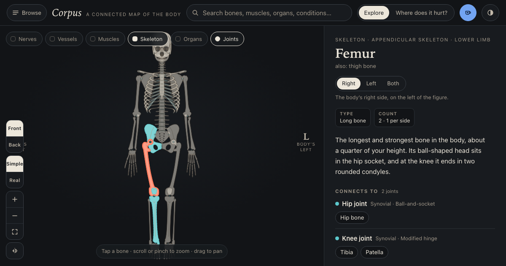

# Corpus

**An interactive map of the human body, treated as one connected system.**

### [▶ Open Corpus → shawoll.github.io/corpus](https://shawoll.github.io/corpus/)

[](https://shawoll.github.io/corpus/)

Tap any bone, joint, muscle, organ, nerve or blood vessel to see what it is, what it connects to and what commonly goes wrong. Switch to **Where does it hurt?**, tap a body area, and see what lies there, the usual causes of pain and when to get help.

> [!WARNING]
> **Corpus is not a diagnostic tool.** It is for learning about the body only. It does not give medical advice, cannot examine you or take your history, and must not be used to diagnose or treat anything. If you are in pain or worried about your health, see a doctor or pharmacist. **In an emergency, call your local emergency number.**

## What's inside

- **Skeleton**: all 206 bones and 33 joints
- **Muscles**: 45 muscles and muscle groups, with origin, insertion, nerve and blood supply
- **Organs**: 21 major organs, from the brain to the bladder
- **Vessels**: 38 major arteries and veins, with pulse points
- **Nerves**: the spinal cord, cranial nerves, plexuses and the main limb nerves
- **Where does it hurt?**: 28 body areas with likely causes, urgency and red flags

Every layer is drawn from the **front** and the **back** (the skeleton also in a realistic style), and everything is linked: a bone lists the muscles that attach to it, a muscle lists its nerve and artery, and so on.

## Features

- Search, a browse drawer and keyboard access to every structure
- Zoom, pan and **Mirror**, which flips the figure to match your own body
- Light and dark themes, works on phones
- No sign-up, no tracking, no external requests

## Run it locally

```sh
python3 -m http.server 8000
# open http://localhost:8000
```

It is plain HTML, CSS, JavaScript, JSON and SVG, with no build step and no dependencies. It deploys to GitHub Pages as-is. For the project layout, data shapes and how to add a layer, see [CONTRIBUTING.md](CONTRIBUTING.md).

## Support

If Corpus is useful to you, you can [buy me a coffee on Ko-fi](https://ko-fi.com/A6H428CUW3). ☕
